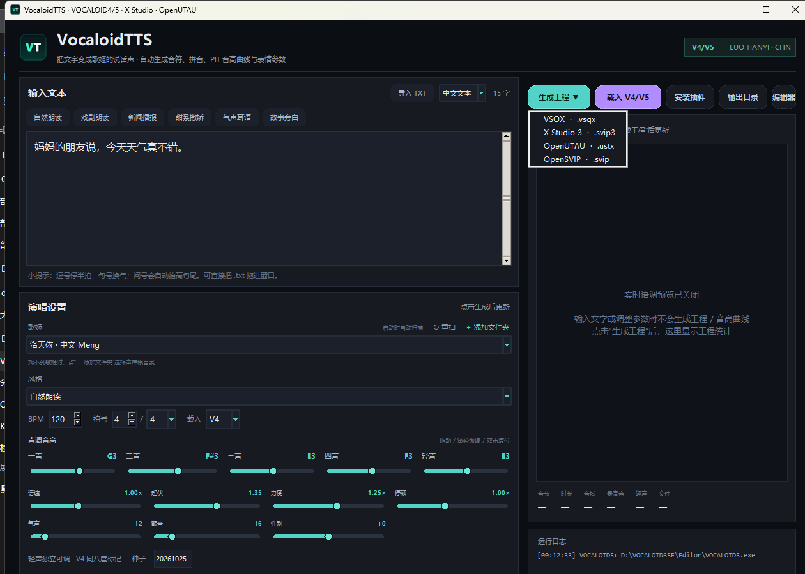
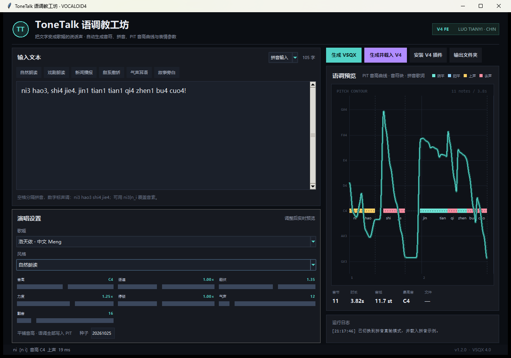
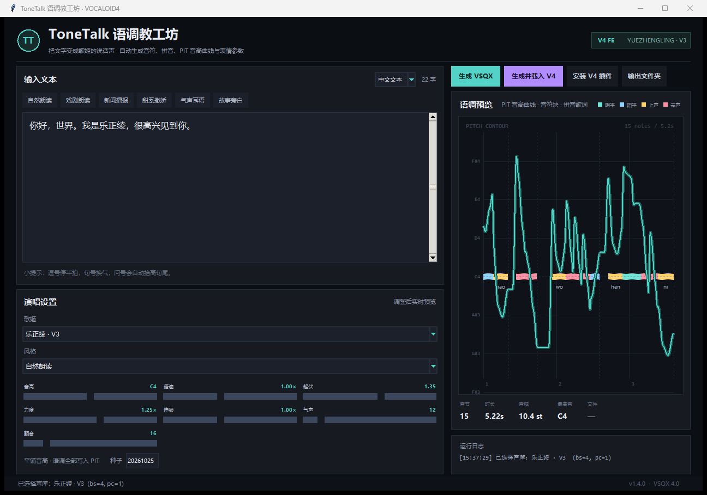
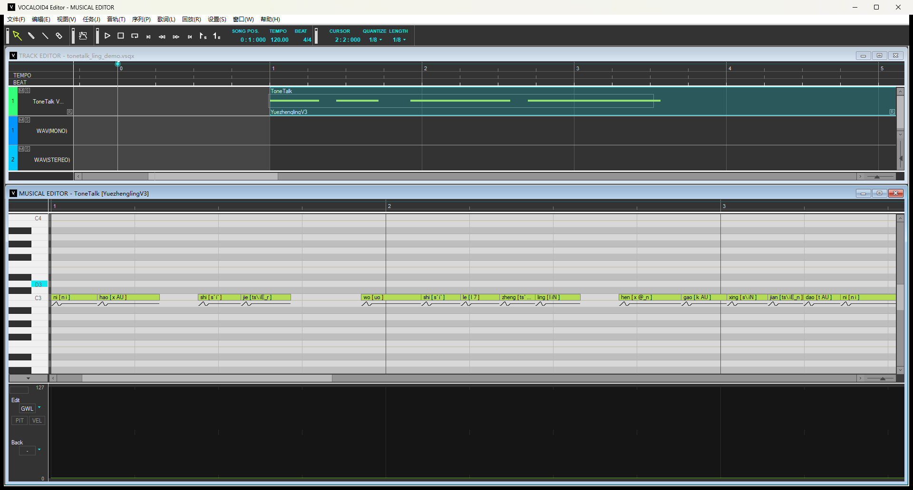

# VocaloidTTS

[](LICENSE)


> 把文字变成歌姬的「说话声」：自动生成音符、拼音歌词、PIT 音高曲线与 DYN/BRI/CLE/OPE 表情参数，输出 VOCALOID4/5 的 `.vsqx`，也可导出 X Studio 3 `.svip3`、OpenUTAU `.ustx` 与 OpenSVIP `.svip`；附带一个可选的 V4 Job Plugin。

**开源仓库**：[jinyiwei2012/VocaloidTTS](https://github.com/jinyiwei2012/VocaloidTTS)。本仓库以 MIT 协议公开 v1.1 源码基线，包含源码、图标、演示工程与发布展示页；EXE、ZIP、Python 缓存和构建目录不纳入 Git。首次从 GitHub 获取项目请按「从源码运行」操作，需要 EXE 时可按「构建」一节自行打包。

## 版本说明

### v1.2.0（当前源码）

- **生成进度与取消**：状态栏出现进度条、百分比和「✕ 取消」。进度按五个阶段的实测耗时分配，长文本不会停在某个数字上；取消会在最近一个检查点停下，结果是「已取消」而不是报错，也不会留下半个工程。
- **声库扫描移到后台**：窗口先显示，扫完再填下拉框；「重扫」和「添加文件夹」同样不再卡界面。声库列表为空是一个正常状态，不再需要假声库占位。
- **逐字纠音**：选中文字点「纠音」，可以逐字改拼音、声调，以及设置强调、拉长和精确停顿。人工设置永远盖过自动规则；文本改动后偏移对不上的纠音会被整体忽略并记日志，不会错配到别的字上。
- **用户词典**：`词语 → 带声调拼音`，跨项目共享，存在 `%APPDATA%\VocaloidTTS\userdict.json`。
- **项目文件**：`.vttsproj` 保存原文、输入模式、BPM/拍号、全部参数和逐字修改；每 2.5 秒自动存一份到 `autosave.vttsproj`，下次启动自动恢复。
- **音高预览**：点「预览音高」按当前文本与参数算一次，画出音高曲线和换气点，不随打字重算。
- **编辑器连接更稳**：查找 V4/V5 窗口时要求窗口属于对应进程，标题相近的其他窗口不会被误认；载入失败会说明卡在哪一步，并提供「打开文件所在文件夹」的出口。

后续路线与验收标准见 [PLAN.md](PLAN.md)，已知问题与改进候选见 [docs/improvements.md](docs/improvements.md)，取舍记录见 [AI_DECISIONS.md](AI_DECISIONS.md)。

### v1.1.1

- 修复中英文混排顺序，以及 F/W 等字母读法被截断的问题。
- 修复百分数、万位分组补零和英文句点停顿，保留小数、年份和电话号码的读法。
- 修复 X Studio 3 导出遗漏音符基准音高的问题，按实际 PBS 换算音高偏移。
- 优化长文本音域统计和多格式导出中的曲线查找。
- 新增无需声库的回归测试，以及 Windows Python 3.10 / 3.14 CI。
- 该版本的验证记录见 [docs/validation-v1.1.1.md](docs/validation-v1.1.1.md)。

### v1.1

- 版本 **1.1**；顶部主按钮改为 **生成工程 ▼**，可选四种格式：
  - **VOCALOID VSQX**（V4/V5 原生工程）
  - **X Studio 3**（`.svip3`）
  - **OpenUTAU**（`.ustx`）
  - **OpenSVIP**（`.svip` JSON）
- 新增 **性别** 滑条（-100..100，默认 0）；音高、动态、气声、性别会尽量映射到目标格式。
- X Studio 3 歌手写为 **洛天依**。X Studio 没有公开的洛天依 UUID，因此临时借用内置女声「陈水若」的 ID 作为占位；轨道名仍是洛天依，打开后可在 X Studio 里改选歌手。
- OpenUTAU 只写 **占位歌手**，不绑定真实声库；打开工程后请选择本机声库。
- OpenSVIP `.svip` 为 JSON 交换工程，便于继续交给 OpenSVIP 转换器处理。

### v1.0

- 软件正式更名为 **VocaloidTTS**，版本 **1.0**。
- 新图标：深色圆角底 + VT 字样，窗口、任务栏、托盘统一使用。
- 点窗口关闭按钮**驻留系统托盘**，右键托盘图标选择「退出 VocaloidTTS」。
- **取消实时语调预览**：输入文字、拖动参数不再触发 VSQX / 音高曲线生成，只有点 **生成工程** 时才计算。
- **支持导入 TXT**：点输入框右上角「导入 TXT」，或直接把 `.txt` 拖进窗口；修复了拖拽时偶发的 Tk 重入崩溃。
- **声库自动扫描增强**：每次启动扫描注册表、`VoiceDB` 和所有固定磁盘；找不到时点「歌姬」右侧 **＋ 添加文件夹**，目录会持久保存，下次启动继续扫描。
- 支持 **VOCALOID4 / VOCALOID5**，V5 可直接打开生成的 VSQX。
- BPM / 拍号可调，五声滑条、轻声独立、二/四声强化曲线全部保留；发声时长/停顿时长完全回到 **1.10**（基础 232ms、句末 1.26 倍、标点 1.05 倍）；PIT 分析/控制点加密到约 **5ms**，并做约 **40ms** 平滑：曲线更细、更顺，同时保留 1.10 的时长与连贯语流。

> **八度已统一**：工具和 V4/V5 都使用 C3=60 标记。一声默认 G3 = MIDI 67，V4/V5 显示 G3。若打开的是旧版生成的工程，仍会看到旧的低八度 G2，需要用 VocaloidTTS v1.0 重新生成。



---

## 开发历史

> 下面 v1.1–v1.12 是 1.0 之前的**内部迭代号**，与当前发布的 **VocaloidTTS 1.1** 不是同一套版本号。

| 版本 | 变化 |
|---|---|
| v1.1 | 表现力增强：默认音高跨度从约 5 个半音提升到约 8–10 个半音，加入句内焦点重音、局部音高突显、更宽的 DYN 动态、分音节力度（velocity）和更明显的句末/停顿处理；新增「戏剧朗读」风格，以及「起伏 / 力度」两个独立旋钮。 |
| v1.2 | 拼音直输模式：输入框右上角可切换「中文文本 / 拼音输入」，完全跳过汉字→拼音的多音字判断；支持声调数字、声调符号，以及 `ni3\|n_i` 这种逐音节音素覆盖。 |
| v1.3 | 舌尖元音修正：`zi / ci / si` 与 `zhi / chi / shi / ri` 的韵母映射修正。`shi` 改用舌尖后元音 `` i` ``，`si` 改用舌尖前元音 `i\`。「世界」的「世」现在会使用正确的翘舌音素。 |
| v1.4 | 声库自动扫描：启动时同时扫描 VOCALOID4/VOCALOID3 注册表和 `Program Files*\VoiceDB` 目录，能发现没有登记到 V4 `DATABASE` 注册表里的 V3 声库。乐正绫 V3 会显示为 **乐正绫 · V3**，选中后生成的 VSQX 会写入正确的 `bs=4 / pc=1 / id=BE8A88G3FWXLTEBD`，在 V4 中直接以 `YuezhenglingV3` 打开。 |
| v1.5 | 四声与轻声：`一声` 现在是第一声的基准音高（默认 G3），三声/四声/轻声会自动落在它下方；新增中文常见轻声词、动词重叠、`地/得` 补语识别。启动时还会检查 VOCALOID4 路径，找不到就提示选择（生成 VSQX 本身不依赖 V4）。 |
| v1.6 | 四声独立滑条 + 圆角 UI：一声、二声、三声、四声各有独立滑条（默认 G3 / F#3 / E3 / G3），可单独抬高或压低某一声；滑条改为圆角轨道 + 圆形旋钮，支持点击、拖动、滚轮、方向键和双击复位；按钮与预设胶囊也改为圆角。 |
| v1.7 | 音符块分调：v1.6 之前所有音符块都固定在一个 MIDI 音高（55），四声只靠 PIT 曲线变化，在 V4 钢琴卷帘里看起来全是同一个 G2。v1.7 让每个音节的**音符本身**落到对应声调基准（55/54/52/53），PIT 只负责声调内部的升降。 |
| v1.8 | 八度对齐 + 按钮修复：本工具改用与 V4 相同的 **C3 = MIDI 60** 标记法，并把四声整体升高一个八度：一声 67、二声 66、三声 64、四声 65。现在工具里写 G3，V4 也显示 G3，不再低一个八度（MIDI 67 ≈ 392 Hz）。旧版设置会自动 +12 半音迁移。按钮重写为更稳的圆角边框 + 固定最小高度 + Map/Configure 重绘，修复部分 DPI 下按钮文字/边框被截断的问题。 |
| v1.9 | 轻声滑条 + 二/四声曲线：新增「轻声」滑条（默认 E3=64），可单独调轻声的音高；二声改为先压低 PIT 再升高，四声改为先升高 PIT 再降低，两者起伏都比之前更明显。 |
| v1.10 | 曲线三倍强化：二声、四声的 PIT 起伏比 v1.9 约放大三倍：二声从 -4.8 半音的低点冲到 +3.45，四声从 +2.55 的高点落到 -11.55；三声也同步加深低降（-0.6 → -2.85 → -0.9），避免三声被焦点重音顶得过高。 |
| v1.11 | BPM/拍号 + PIT 加密：界面新增 BPM 与拍号输入，默认 120 BPM、4/4，可改成 90/3/4、140/6/8 等；Part 起点会按拍号自动落在第 5 小节。PIT 采样从约 10ms 加密到约 5ms，控制点约增加一倍，锯齿感明显减弱。（v1.0 最终采用约 5ms 控制点 + 40ms 平滑，精细度更高。） |
| v1.12 | 支持 VOCALOID5：生成仍是标准 VSQX 4.0；V5 的文件过滤器直接接受 `*.vsqx`，已实测在 VOCALOID5 Editor 中打开。界面新增 **载入 V4/V5** 目标选择和 **V5 路径** 自动检测（注册表 / `D:\VOCALOID6SE\Editor\VOCALOID5.exe`）。V5 不使用 V4 Job Plugin，直接打开 VSQX 即可。 |

---

## 1. 这是什么？

VOCALOID 的传统用法是「先有旋律，再填歌词」。**语调教**反过来：先有一段文字，让歌姬用接近说话的音高和节奏把它「读」出来，同时保留歌姬的音色。

VocaloidTTS 做的事情：

1. 把中文文本切成音节，转成拼音与 VOCALOID 中文 X-SAMPA 音素；
2. 用普通话四声 + 句调下倾 + 停顿 + 重音规则，生成一条连续的语音音高曲线；
3. 把曲线写成 VOCALOID4 的 `PIT`（音高弯曲）与 `PBS`（弯曲灵敏度）控制点；
4. 生成每个音节的音符、歌词、音素、力度和 `nStyle`；
5. 同时写入 `DYN`、`BRI`、`CLE`、`OPE`、`BRE`、`GEN`、`POR` 等表情参数；
6. 输出一个可以直接在 **VOCALOID4 FE** 里打开、试听、继续微调、导出 WAV 的 `.vsqx`。

默认采用**分声调音符块 + PIT 内部曲线**：每个音节的音符落在自己的声调基准（G3/F#3/E3/F3），PIT 只负责该声调内部的升降。这样 V4/V5 钢琴卷帘里能看到四声的高度差，又不会在音符边界产生多余滑音。

---

## 2. 快速开始

### 方式 A：使用打包好的 EXE（推荐）

1. 双击 `VocaloidTTS.exe`；
2. 在左上角选择 **中文文本** 或 **拼音输入**；
3. 在左侧输入文字/拼音，或点一个预设（自然朗读 / 戏剧朗读 / 新闻播报 / 甜系撒娇 / 气声耳语 / 故事旁白）；
4. 输入或粘贴文字；
5. 点 **生成工程 ▼**，选择格式：
   - `VOCALOID VSQX`（默认）
   - `X Studio 3 (.svip3)`
   - `OpenUTAU (.ustx)`
   - `OpenSVIP (.svip)`
6. 保存到 `文档\VocaloidTTS\`；
7. 用对应软件打开：
   - V4/V5：`Ctrl+O` 打开 `.vsqx`
   - X Studio 3：打开 `.svip3`，在歌手处把临时借用的陈水若改选为洛天依（如已安装）
   - OpenUTAU：打开 `.ustx`，给占位轨道选择本机声库
8. 试听；V4/V5 可用 `文件 → 导出 → 波形` 导出 WAV。

也可以点 **载入 V4/V5**：程序会按「载入」下拉框选择 V4 或 V5，尝试通过 Win32 消息 / Ctrl+O 自动完成「打开文件」对话框。V5 已实测可用；V4 的窗口结构较特殊，失败时手动 `Ctrl+O` 即可。

### 方式 B：从源码运行

```bat
git clone https://github.com/jinyiwei2012/VocaloidTTS.git
cd VocaloidTTS
python -m venv .venv
call .venv\Scripts\activate.bat
python -m pip install -r requirements.txt
python VocaloidTTS.py
```

以上命令适用于 Windows 命令提示符（cmd）；PowerShell 中使用 `.\.venv\Scripts\Activate.ps1` 激活环境。需要 Python 3.10+、Windows 10/11。Tkinter 随 Python 官方安装包提供。

---

## 3. 界面与参数

| 参数 | 作用 | 建议 |
|---|---|---|
| 歌姬 | 启动自动扫描 + 手动添加文件夹 | 本机测试：洛天依 · 中文 Meng、乐正绫 · V3 |
| 风格 | 一键套用一组语速/语调/气声/颤音，同时重置五个声调基准 | 先选风格，再微调 |
| **BPM** | 生成工程的速度 | 默认 120；40–240 |
| **拍号** | 每小节拍数 / 音符单位 | 默认 4/4；支持 3/4、6/8 等 |
| **一声** | 阴平的基准音高 | 默认 G3（MIDI 67）；甜系可 A3，低沉可 F3 |
| **二声** | 阳平的基准音高（曲线在基准上下小幅上升） | 默认 F#3（66）；想更明亮可 G3 |
| **三声** | 上声的基准音高（低降后回升） | 默认 E3（64）；压低可 D3 |
| **四声** | 去声的起点基准（从附近下落到更低） | 默认 F3（65）；想更重可 G3 |
| **轻声** | 轻声的基准音高，独立滑条 | 默认 E3（64）；更低沉可 D3 |
| 语速 | 音节时长与停顿的整体缩放 | 0.9–1.15 |
| **起伏** | 句调、焦点重音、局部音高变化的强度 | 1.2–1.5 自然；1.6–1.9 戏剧化 |
| **力度** | DYN 动态范围、起音冲击、velocity 强弱 | 1.1–1.4 自然；1.5–1.7 有力 |
| 停顿 | 逗号/句号停顿的缩放 | 0.8–1.2 |
| 气声 | BRE / CLE 的配比 | 12–25 更自然 |
| **性别** | GEN 性别参数，并映射到目标格式 | 默认 0；-100 更低沉，+100 更明亮 |
| 颤音 | 长音 PIT 上的轻微颤音 | 10–22；新闻播报可 0–8 |
| 种子 | 控制微小的时长/音高随机扰动 | 固定种子可复现 |

> **声调音高**：五个滑条各自独立。默认一声 G3（67）、二声 F#3（66）、三声 E3（64）、四声 F3（65）、轻声 E3（64）；二声从基准下方先压低再升起，三声在 E3 附近低降回升，四声先升后落到 C#3/D3，轻声最低、最短、最弱。滑条可以拖动、滚轮微调、方向键调整，双击恢复该滑条默认值。

**圆角 UI**：滑条是圆角轨道 + 圆形旋钮；按钮、预设胶囊也使用圆角绘制，悬停有高亮反馈。

> 想要「更有起伏、更有力度」：先把 **起伏** 拉到 1.55–1.8，**力度** 拉到 1.45–1.65；语速降到 0.92–0.98；或直接选 **戏剧朗读**。如果觉得太夸张，把起伏降回 1.2–1.3。

### 3.1 拼音直输模式



适合以下情况：

- 汉字多音字被读错，你想手动指定读音；
- 你想精确控制声调；
- 你想直接用 `ni3 hao3` 这类拼音写歌词；
- 某个音节的音素仍不对，想手动覆盖。

**基本写法**：空格分隔音节，数字 1–5 表示声调，5 或 0 表示轻声。

```text
ni3 hao3, shi4 jie4.
jin1 tian1 tian1 qi4 zhen1 bu4 cuo4!
```

也支持带声调符号的拼音：

```text
nǐ hǎo，shì jiè！
```

**标点停顿**：`，、,` 为短停顿；`。！？；：.!?;:` 为句末/长停顿。换行也会产生停顿。拼音模式不会自动做上声变调（3+3）或「一/不」变调，因为你输入的声调就是最终声调。

**逐音节音素覆盖**：在音节后加 `|`，用下划线代替空格：

```text
ni3|n_i hao3 shi4|s`_i` jie4|ts\_iE_r
```

- `ni3|n_i` → 拼音 `ni`、声调 3、音素 `n i`
- `` shi4|s`_i` `` → 音素 `` s` i` ``（sh 的翘舌音 + 舌尖后元音）
- 覆盖只影响该音节，不影响其他音节。

**已修正的常见映射**：

- `bo / po / mo / fo` → `p uo / p_h uo / m uo / f uo`（之前错误地写成 `o`）
- `nue / lue` 按 `nüe / lüe` 处理
- `ju / qu / xu / jue / juan / jun` 按 `ü` 系列处理
- `zi / ci / si` 使用舌尖前元音 `i\`：`ts i\`、`ts_h i\`、`s i\`
- `zhi / chi / shi / ri` 使用舌尖后元音 `` i` ``：`` ts` i` ``、`` ts`_h i` ``、`` s` i` ``、`` z` i` ``
- `yo` 按 `j o` 处理

**v1.3 验证**：对「世界」的「世」做了频谱对比，`/sh/` 摩擦段频谱重心从旧版约 **3033 Hz** 降到 **1875 Hz**，符合翘舌音（retroflex）比平舌音更暗的特征；同时 V4 能正常加载 `` s` i` `` 音素并渲染。

如果生成时提示「无法识别拼音」，检查该音节拼写，或用 `拼音|音素` 覆盖。

**实时预览已关闭**：输入、切换声库、拖动滑条时都不会计算音高或写工程；右侧只显示「生成信息」和运行日志。点 **生成工程 ▼** 选择格式后，才会生成并显示音节数、时长、音域、最高音、轻声数和文件大小。

**导入 TXT**：点「导入 TXT」选择文件，或把 `.txt` / `.text` / `.md` 直接拖进窗口。自动识别 UTF-8（含 BOM）、UTF-16 和 GB18030；超过 20 万字符会截断并提示。导入只替换文本框内容，不触发渲染。

### 3.2 声库自动扫描与手动添加



**每次启动都会自动扫描**，不需要手动点「扫描」：

- `HKLM\SOFTWARE\WOW6432Node\VOCALOID4\DATABASE`
- `HKLM\SOFTWARE\WOW6432Node\VOCALOID3\DATABASE`
- `HKLM\SOFTWARE\VOCALOID4\DATABASE` / `VOCALOID3`
- `%ProgramFiles(x86)%\VoiceDB`、`%ProgramFiles%\VoiceDB`、`C:\VoiceDB`
- V4/V5 安装目录旁的 `VoiceDB` / `VoiceBank`
- 所有固定磁盘根目录下的 `VoiceDB`、`VoiceBank`、`VOCALOID*\VoiceDB`
- 以及你手动添加过的声库目录（会持久保存）

扫描在后台线程进行，窗口不会等它出结果：声库下拉框先空着，扫完自动填上。扫描只读目录名和 `.vvd` 文件名，不加载几 GB 的 `.ddb`，通常几十毫秒内完成。

**如果声库装在非常规目录**：

1. 点「歌姬」右侧的 **＋ 添加文件夹**；
2. 选择声库根目录、`VoiceDB`、或包含多个歌姬的上级文件夹；
3. 软件会递归查找 `.vvd`，找到后加入下拉框；
4. 目录会写入 `%APPDATA%\VocaloidTTS\voicebank_roots.txt`，**下次启动继续自动扫描**。

点 **↻ 重扫** 可以立即重新扫描；不会重新加载几 GB 的采样文件。

**管理点位**：点 **管理点位…** 可以查看已添加的目录、移除、编辑 `bs/pc` 覆盖，或导入/导出 JSON 清单。配置保存在 `%APPDATA%\VocaloidTTS\voicebank_roots.json`，旧的 `voicebank_roots.txt` 会在首次启动时自动迁移。

**最近工程**：生成成功后会记录最近 10 个工程；`生成工程 ▼` 菜单底部的 **最近工程** 可以直接用默认程序重新打开。

在「歌姬」下拉框里会看到：

```text
洛天依 · 中文 Meng
乐正绫 · V3
```

选中乐正绫 V3 后生成 VSQX，文件里会写入：

```xml
<vVoice>
  <bs>4</bs>
  <pc>1</pc>
  <id>BE8A88G3FWXLTEBD</id>
  <name>YuezhenglingV3</name>
</vVoice>
```

V4 打开时会直接显示 `VocaloidTTS [YuezhenglingV3]`，无需手动改歌手。



**为什么乐正绫 V3 以前不显示？** 因为 V3 声库安装后只把文件放进 `VoiceDB`，不一定写入 V4 的 `DATABASE` 注册表；旧版 VocaloidTTS 只读注册表，所以漏掉了。v1.4 增加了文件目录扫描。

**声库目录的三种形态**（排查时可对照）：

| 版本 | 组件目录里的文件 | 说明 |
|---|---|---|
| V3 | `<声库名>.vvd` + `.ddb` + `.ddi` | `.vvd` 文件名就是声库名，识别正常 |
| V4 | `<声库名>.vvd` + `.ddb` + `.ddi` | 同上 |
| V5 | `_v4compatible.vvd` + `.ddb` + `.ddi` | 只有一个 237 字节的兼容标记，没有真名 `.vvd` |

当前版本按以下顺序识别声库名：真名 `.vvd` → `.ddi` → `.ddb`；`_v4compatible.vvd` 只当兼容标记，不会成为声库名。版本从 `EULA` 文件名（如 `LICENSES_V5_...`）、路径（`v3声库`）或文件名（`MIKU_V4_...`）判断，显示成「洛天依 · 中文 Meng · V5」这样的形式。

**如果某个声库显示了但 V4 里不发声**，通常是 `bs/pc` 不对。可以在 `%APPDATA%\VocaloidTTS\voicebanks.json` 里覆盖（重启 VocaloidTTS 生效）：

```json
{
  "BE8A88G3FWXLTEBD": {
    "bs": 4,
    "pc": 1,
    "display": "乐正绫 · V3"
  }
}
```

键可以是组件 ID（文件夹名）或 `.vvd` 文件名（如 `YuezhenglingV3`）。内置已知映射已包含洛天依 V4 和乐正绫 V3；其他不认识的库会先按目录扫描出来，再用默认 `bs/pc`，需要时用上面的 JSON 修正。

### 3.3 编辑器路径检测

启动时会检查两个编辑器。

**VOCALOID4**

1. 先读上次保存的路径 `%APPDATA%\VocaloidTTS\v4_path.txt`；
2. 没有保存路径时，检查 `C:\Program Files (x86)\Vocaloid4FE\VOCALOID4.exe`；
3. 都找不到才提示。

**VOCALOID5**

1. 先读 `%APPDATA%\VocaloidTTS\v5_path.txt`；
2. 再查注册表 `HKLM\SOFTWARE\VOCALOID5\Application\Components\*\Path`；
3. 再检查 `D:\VOCALOID6SE\Editor\VOCALOID5.exe`、`C:\Program Files\VOCALOID5\VOCALOID5.exe` 等常见位置。

生成 VSQX 本身**不依赖**编辑器；找不到 V4/V5 时仍然可以生成、试听曲线。只有以下功能需要路径：

- 载入 V4/V5
- 安装 V4 Job Plugin
- 自动打开/控制编辑器

界面右侧的 **载入** 下拉框选择 `V4` 或 `V5`，再点 **载入 V4/V5**。点 **编辑器** 按钮可以分别设置 V4 或 V5 路径；同时检测到两者时会询问设置哪一个。路径必须指向 `VOCALOID4.exe` / `VOCALOID5.exe` 本体，不能是快捷方式。

**V5 兼容性**：V5 的文件过滤器是 `VOCALOID 工程 (*.vpr;*.vsqx)`，本工具生成的 VSQX 4.0 可以直接打开（已实测）。V5 **不使用** V4 Job Plugin，直接 `文件 → 打开` 选择 `.vsqx` 即可；安装插件时如果只检测到 V5，会提示这一点。

### 3.4 轻声识别与生成

中文模式会自动识别常见轻声，并生成：

- 更短：约普通音节的 0.58 倍
- 更低：明显低于三声基准
- 更弱：DYN / velocity 更低，`opening` 也更小
- 音高曲线平缓，不做重音上挑

已覆盖：

- 语气词：的、了、着、吗、呢、吧、啊、嘛、呀
- 常见轻声词：妈妈、爸爸、朋友、时候、东西、明白、知道、喜欢、便宜、舒服、漂亮、意思、故事、月亮、衣服、眼睛、耳朵、头发、桌子、椅子、儿子、我们、什么、怎么、一个……
- 动词重叠：看看、试试、说说、想想、听听、走走……
- 副词/补语：慢慢地、轻轻地、高兴地、跑得快、说得好、觉得、记得、懂得……

拼音模式直接写 `5` 或 `0` 即可，例如：

```text
ma1 ma5 de5 peng2 you5 shuo1
```

生成后统计栏会显示识别到的轻声数量。

**生成期间**：解析、排时序、算音高和写文件都在后台线程跑，窗口不会卡住。状态栏会出现进度条、百分比和 **✕ 取消**：

- 进度按五个阶段的实测耗时分配，长文本不会停在某个数字上不动；
- 点取消会在最近一个检查点停下（每 64 个音节或 512 个采样点检查一次），结果是「已取消」，不是报错；
- 取消发生在写文件之前，所以不会留下半个工程；已经写好的旧文件保持原样。

### 3.5 多格式导出（X Studio / OpenUTAU / OpenSVIP）

点顶部 **生成工程 ▼** 选择格式。四种格式共用同一份 `Song` 数据（音符、PIT、DYN、BRE、GEN 等），不需要重复调参。

| 格式 | 扩展名 | 用途 / 说明 |
|---|---|---|
| VOCALOID VSQX | `.vsqx` | V4/V5 原生工程；仍会刷新 V4 Job Plugin 数据 |
| X Studio 3 | `.svip3` | 网易云 X Studio 3 工程；protobuf 手写，无额外依赖 |
| OpenUTAU | `.ustx` | OpenUTAU 0.10 YAML 工程；PIT 写入每个音符的 pitch 曲线 |
| OpenSVIP | `.svip` | OpenSVIP JSON 交换工程，可继续交给 OpenSVIP 转换器 |

**X Studio 3 歌手**：X Studio 没有公开的洛天依 UUID，所以导出时临时借用内置女声「陈水若」的 ID，轨道名仍写「洛天依」。打开 `.svip3` 后，如果本机有洛天依声库，请在 X Studio 的歌手选择器里改选；实际加载和发声仍需在目标版本中验证。

**OpenUTAU 歌手**：只写占位名「洛天依」，不绑定真实声库；打开 `.ustx` 后请在轨道上选择本机安装的歌手/渲染器。PIT 是逐音符 `pitch.data`，DYN/BRE/GEN 是 part 曲线。

**OpenSVIP**：`.svip` 是 JSON 交换格式，适合再用 OpenSVIP 转成其他工程；字段按公开 model 写，属于实验性导出。

**性别**：界面新增「性别」滑条（-100..100，默认 0），映射到 VSQX 的 GEN、OpenUTAU 的 `gen` 曲线及实验性 OpenSVIP JSON 的 gender 字段；X Studio 3 尚未映射此参数。

---

## 4. V4 Job Plugin（可选）

> **V5 不使用此插件。** V5 直接打开生成的 `.vsqx` 即可；插件只适用于 VOCALOID4 的 JobPlugins 目录。

插件文件：`jobplugin/VocaloidTTS.lua`

### 安装

1. 在 VocaloidTTS 里点 **安装 V4 插件**，它会把插件复制到：
   `C:\Program Files (x86)\Vocaloid4FE\JobPlugins\VocaloidTTS.lua`
2. 打开 V4 → `任务(J)` → `管理任务插件(M)...` → **添加** → 选择上面的 `VocaloidTTS.lua` → **确定**；
3. 之后在 `任务(J)` → `任务插件` 里就能看到 **VocaloidTTS 语调教导入**。

### 使用

1. 先在 VocaloidTTS 里生成一次（会刷新 `%LOCALAPPDATA%\VocaloidTTS\vocaloidtts_job.txt`）；
2. 在 V4 里新建/选中一个 Musical Part；
3. `任务(J)` → `任务插件` → **VocaloidTTS 语调教导入**；
4. 保持默认路径，设置插入位置（Tick，0 = 序列开头），勾选「先清除目标范围内的旧音符」；
5. 确定后，音符和全部控制点会写入当前 Part。

适合「已经有一个工程，只想把一段话加到第 5 小节」的场景。

---

## 5. 工作原理（给想改参数的人）

### 5.1 文本 → 音节

- `pypinyin` 的 `TONE3` 风格取拼音与声调；按整段中文 run 调用，保留 `目的/着急/了解/觉得` 这类词组读音；
- 处理常见变调：上声+上声（3+3）、「一/不」变调；
- 轻声识别：常见轻声词 + 语气词 + 动词重叠 + `地/得` 补语规则，命中后改为 tone 5；
- 数字按年份/电话号码/普通整数分别读；
- 标点决定停顿：逗号 230 ms、句号 420 ms、问号 400 ms、感叹号 380 ms（再乘「停顿比例」）；
- 中文音节转 X-SAMPA 音素，例如：
  - `ni` → `n i`
  - `hao` → `x AU`
  - `shi` → `` s` i` ``（舌尖后）
  - `si` → `s i\`（舌尖前）
  - `jie` → `ts\ iE_r`
- **拼音模式**跳过上面的汉字识别，直接把每个拼音 token 按声母/韵母表转成音素。拼音 token 支持 `ni3`、`nǐ`、`ni3|n_i` 三种写法；不自动做变调，保留你输入的声调。
- **舌尖元音**：`zi / ci / si` 的韵母是舌尖前元音 `i\`，`zhi / chi / shi / ri` 是舌尖后元音 `` i` ``。这两组不能都用普通 `i`，否则「世 / 四」「知 / 资」会混淆。

### 5.2 音高模型

五个声调各有独立基准（MIDI）：一声 67（G3）、二声 66（F#3）、三声 64（E3）、四声 65（F3）、轻声 64（E3）。每一声的曲线是相对自己基准的半音偏移：

| 声调 | 曲线（相对本声调基准） | 默认基准下的大致音高 |
|---|---|---|
| 阴平 1 | 0 → +0.14 → 0 | G3 |
| 阳平 2 | -2.10 → -4.80 → -3.00 → +0.90 → +3.45 | F#3 先深压，再大幅升到 G#3 |
| 上声 3 | -0.60 → -2.55 → -2.85 → -0.90 | E3 附近更深地低降回升 |
| 去声 4 | +1.05 → +2.55 → +1.05 → -4.95 → -11.55 | F3 先冲高，再落到低音区 |
| 轻声 5 | -0.2 → -0.6 | E3 附近，更短更弱 |

再叠加（幅度比 v1.3 小，避免把各声调推离基准）：

- 句调下倾（陈述句约 +0.12×起伏 → -0.42×起伏 半音）；
- 句内拱形（长句中部再抬 0.16×起伏 半音）；
- 焦点重音：每个短语选一个主要重音，额外 +0.45 强度，并在音节起点做局部音高突显；
- 句末下降（陈述）或上升（疑问，句尾最高可 +0.55×起伏 半音）；
- 90 ms 的音节间滑音；
- PIT 分析/控制点约 **5 ms**，比 1.10 的 10ms 更细，曲线转折更自然；
- 全局平滑约 **40 ms**，削弱折线锯齿，同时保留 1.10 的时长和连贯发声；
- 长音的可选颤音（5.4 Hz，PIT 内实现，最大深度约 0.24 半音）。

所以五个滑条可以单独把某一声抬高或压低：例如把二声拉到 G3，阳平就会从 F#3 升到 G3；把三声压到 D3，上声整体会更低；轻声也由自己的滑条独立控制。

**音符块也分调**：生成时每个音节直接使用对应声调的 MIDI 基准（67/66/64/65/64），PIT 只写该声调内部的升降。因此 V4 钢琴卷帘里不是一排相同的 G2，而是 G3 / F#3 / E3 / F3 等不同高度的音符块；v1.8 已统一使用 V4 的 C3=60 标记，不再有八度错位。

### 5.2.1 力度模型

- **DYN**：每个音节有独立的起音、保持、衰减包络；重音音节峰值更高、起音更快，停顿处降到 20 左右，形成明显的强弱对比。
- **velocity**：按重音与「力度」计算（约 24–118），影响 V4 的起音和音色冲击。
- **轻声**：tone 5 的时长约为普通音节的 0.58 倍，velocity/DYN 都更低，`opening` 从 127 降到 112，音高曲线落在三声基准下方。
- **nStyle accent**：按重音与力度提升到 30–100，让辅音和起音更有「咬字感」。
- **BRI**：重音音节更亮，气声风格更暗。

### 5.3 VSQX 的关键细节

这是本项目踩过的坑，写出来方便二次开发：

- 控制点的 `id` 在 **VSQX 里是 `P`（PIT）和 `S`（PBS）**，不是 `PIT` / `PBS`；后者是 Job Plugin API 的名字。
- `PBS = 12` 表示音高弯曲范围 ±12 半音；`PIT` 值换算：`PIT = 半音数 × 8192 / PBS`。
- `cc` 与 `note` 的 `t` 都是 **相对 Part 起点** 的本地 Tick。
- Part 的 `t` 必须是 4 个预小节之后：`measure_ticks × 4`。4/4 + 480 分辨率时是 `7680`；3/4 是 `5760`，6/8 也是 `5760`。`playTime` 是**绝对结束 Tick**，必须大于最后一个音符。
- 每个 `<note>` 都必须带 `<nStyle>`（accent/bendDep/bendLen/decay/fallPort/opening/risePort/vibLen/vibType），否则 V4 会报 `CVSMusicalNote ... ERROR` 或直接丢弃音符。
- 歌词用拼音（不含声调），音素用 X-SAMPA；`p` 留空时 V4 会默认成 `a`，所以必须显式写音素。
- `resolution = 480`，`tempo = 12000`（BPM×100），`preMeasure = 4`。

工程结构：

```text
vsq4
├─ vVoiceTable / mixer / masterTrack
├─ vsTrack
│  └─ vsPart (t=4×measure_ticks, playTime=...)
│     ├─ sPlug / pStyle / singer
│     ├─ cc  (S, P, DYN, BRE, BRI, CLE, OPE, GEN, POR)
│     ├─ note (t 本地, dur, n, v, y, p, nStyle)
│     └─ plane
├─ monoTrack / stTrack
└─ aux
```

---

## 6. 常见问题

**Q：V4 提示「无法打开指定文件 / Invalid VSQ4 file」？**
A：确认文件是 VocaloidTTS 生成的原始 `.vsqx`，不要手工改 XML；确认 V4 是 4.2.x。生成后可以先用 `vsq4.xsd` 校验（项目开发时已通过）。

**Q：生成后没有声音？**
A：检查 V4 是否加载了声库、Part 是否在播放范围内、是否 Solo/Mute；先按空格播放，看播放头是否经过第 5 小节。

**Q：某个字读音不对？**
A：中文模式现在用词组级 `pypinyin`，但多音字仍可能错。可切到「拼音输入」直接写拼音，或用 `ni3|n_i` 覆盖音素；也可以在 `vocaloidtts/pinyin.py` 的音素表里加规则。

**Q：V4/V5 路径找不到 / 换了安装位置？**
A：点右上角 **编辑器**，选择 `VOCALOID4.exe` 或 `VOCALOID5.exe` 本体。V4 路径保存到 `%APPDATA%\VocaloidTTS\v4_path.txt`，V5 保存到 `v5_path.txt`；下次启动自动使用。生成 VSQX 不依赖编辑器。

**Q：轻声识别不准？**
A：轻声词表在 `vocaloidtts/pinyin.py` 的 `_NEUTRAL_WORDS` / `_DI_ADVERBS` / `_DE_VERBS` 里，可自行补充。最可靠的方式是用拼音模式写 `ma5`、`de5`。

**Q：一声设成 G3，为什么三声/四声还是比 G3 低？**
A：这就是设计目标。一声是基准，三声整体在它下方，四声从它附近下落到更低；句首/句末的轻微滑音和颤音会让瞬时值有几十音分的偏差。

**Q：「载入 V4/V5」失败？**
A：确认「载入」下拉框选对了目标，且对应编辑器已启动。V4 的自动载入用 Win32 消息模拟「文件 → 打开」，不同窗口布局/缩放可能失败；V5 用 Ctrl+O + 标准文件对话框。失败时手动打开 `.vsqx` 即可，工程本身没有问题。

**Q：插件菜单里没有 VocaloidTTS？**
A：插件不是复制进去就自动出现，需要在 `任务 → 管理任务插件 → 添加` 里注册一次。修改 `.lua` 后，V4 会做哈希校验，建议删除旧条目再重新添加。

**Q：打开旧工程还是低八度 / 全在 G2？**
A：v1.8 起工具与 V4 都使用 C3=60，一声默认 G3=MIDI 67。旧版生成的 `.vsqx` 不会自动变，请用 v1.8 重新生成；旧版设置会在首次启动时自动 +12 半音迁移。

**Q：还是觉得平，想更有起伏、更有力度？**
A：把「起伏」提到 1.55–1.8，「力度」提到 1.45–1.7，语速降到 0.92–0.98；或者直接选「戏剧朗读」。也可以把「颤音」提高到 20–30，让长音更有表情。

**Q：起伏/力度调得太大，听起来很夸张怎么办？**
A：把起伏降回 1.2–1.35、力度降到 1.1–1.3，或改用「自然朗读 / 新闻播报」。音高跨度可在生成后的统计栏看到（单位：半音）。

**Q：程序出错了，日志在哪？**
A：`%LOCALAPPDATA%\VocaloidTTS\log.txt`；超过 1 MB 会自动轮转为 `log.old.txt`。设置恢复、托盘、导出等失败都会记在这里。

**Q：输出 WAV 很长，前面有几秒空白？**
A：V4 的 4 个预小节会被计入导出；120/4/4 时约 8 秒，BPM/拍号变化后长度也会变。用音频软件裁掉前 4 个小节，或在 V4 里把 Part 往前拖到第 1 小节（本工具为了兼容 V4FE 从第 5 小节开始）。

---

## 7. 目录结构

```text
VocaloidTTS/
├─ VocaloidTTS.py                  # 源码入口
├─ VocaloidTTS.exe                 # 打包后的主程序（构建产物）
├─ vocaloidtts/
│  ├─ pinyin.py                    # 文本 → 拼音/音素/停顿
│  ├─ prosody.py                   # 四声 + 句调 + 时长 + 控制曲线
│  ├─ vsqx.py                      # VSQX 4.0 写出
│  ├─ jobfile.py                   # 给 Job Plugin 的紧凑数据
│  ├─ exporters.py                 # X Studio / OpenUTAU / OpenSVIP 导出
│  ├─ voicebank.py                 # 注册表 + VoiceDB 声库扫描
│  ├─ v4bridge.py                  # 可选的「载入 V4/V5」桥
│  ├─ tray.py                      # 系统托盘
│  ├─ paths.py                     # 应用数据目录与旧名迁移
│  └─ app.py                       # Tkinter 界面
├─ jobplugin/VocaloidTTS.lua       # V4 Job Plugin
├─ demo/                           # 演示工程与界面截图
├─ docs/                           # 验证记录与改进候选
├─ tests/                          # 回归测试
├─ tools/benchmark_generation.py   # 性能基准
└─ README.md
```

---

## 8. 构建

```bat
python -m pip install -r requirements.txt pyinstaller
python -m PyInstaller --noconfirm --clean --onedir ^
  --name VocaloidTTS ^
  --icon assets/vocaloidtts.ico ^
  --add-data "jobplugin;jobplugin" ^
  --add-data "assets;assets" ^
  --collect-all pypinyin ^
  VocaloidTTS.py
```

产物在 `dist\VocaloidTTS\VocaloidTTS.exe`。使用 `--onedir` 是为了避免部分 Windows 机器上 onefile 解压临时目录失败的问题。

---

## 9. 已知限制

- 只针对 **中文声库** 优化；日文/英文声库需要换音素表。
- 声库扫描覆盖注册表和常见 `VoiceDB` 路径。如果你的声库装在自定义目录、且没写注册表，需要手动把目录加进扫描路径，或用 `%APPDATA%\VocaloidTTS\voicebanks.json` 指定 `bs/pc`。
- **V5 声库的组件目录只有 `_v4compatible.vvd`**：程序会改用 `.ddi` / `.ddb` 的文件名并标注版本（如「洛天依 · 中文 Meng · V5」）；版本号来自 EULA 文件名，路径与文件名都没有版本线索时显示为未知。
- 未内置映射的声库会显示出来，但 `bs/pc` 可能不对，需要在 `voicebanks.json` 里覆盖后才能正确在 V4 中发声。
- 多音字、儿化、轻声目前是规则+词典，不保证 100% 正确。
- 语调模型是规则驱动的，不是神经网络 TTS；优点是可控、可解释、离线、生成快。
- 「载入 V4/V5」是实验性 Win32 自动化；V5 已实测，V4 在部分系统缩放/主题下可能失败，失败时请手动 Ctrl+O。
- X Studio 3 导出不包含官方洛天依 singer ID；目前临时借用陈水若 ID，打开后请在 X Studio 里改选歌手。
- OpenUTAU 导出只写占位歌手，不绑定真实声库；需要在 OpenUTAU 里手动选择声库/渲染器。
- OpenSVIP `.svip` 是实验性 JSON 交换导出；若转换器版本不同，字段可能需要调整。
- 没有内置试听；试听请在 V4/V5、X Studio 3 或 OpenUTAU 中进行。

### 格式支持与验证范围

| 格式 | 音符 / 歌词 | 音高 | 动态 / 气声 / 性别 | 歌手 | 当前自动验证 |
|---|---|---|---|---|---|
| VSQX | 已写入 | PIT / PBS | 已写入 DYN / BRE / GEN | 当前选择的声库 | XML 解析、音符与控制点字段、插件数据 |
| X Studio 3 | 已写入 | 绝对音高（v1.1.1 修正） | 尚未映射 | 固定借用陈水若 ID | protobuf 解码、音符及绝对音高 |
| OpenUTAU | 已写入 | 音符内相对曲线 | 已写入 dyn / bre / gen | 占位符，需手动选择 | 写出内容中的音高单位与时间换算 |
| OpenSVIP JSON | 已写入 | 实验性相对曲线字段 | 实验性字段 | 固定占位 ID | JSON 解析及现有字段值 |

「已写入」表示当前代码输出对应字段，不代表目标编辑器会完整采用它们。v1.1.1 已修复此前确认的混排、数字、英文句点与 SVIP3 基准音高问题；X Studio 3 的 DYN/BRE/GEN 仍未实现，OpenSVIP JSON 的真实导入兼容性仍需验证。

本轮没有运行目标编辑器试听，既有文档中的历史实测记录不等于本次验证。导出、打开、试听、保存和重新打开的完整兼容性验收列在后续计划中。

### 开发验证

在已安装 `requirements.txt` 的环境运行：

```bat
python -B -m unittest discover -s tests -v
python tools/benchmark_generation.py
```

测试使用 Python 标准库 `unittest`，不需要安装声库、启动 GUI 或目标编辑器。性能脚本在临时目录输出文件，比较完整扫描与时间索引，并核对音域和导出字节一致性；不把机器耗时作为 CI 通过条件。

---

## 10. 致谢与声明

- 拼音数据与分词建议：[pypinyin](https://github.com/mozillazg/python-pinyin)（MIT）。
- VSQX 结构参考：VOCALOID4 自带 `vsq4.xsd`、Job Plugin SDK、以及 [3c1u/vsqx](https://github.com/3c1u/vsqx) 的测试工程。
- PIT/PBS 的 VSQX 表示参考：[EDITUNE](https://js-bach.org/vsqx/editune.html)（小川P）。
- VOCALOID 是 Yamaha 的商标；本项目与 Yamaha 无隶属关系。声库、编辑器及相关商标的权利归各自权利人所有，请遵守其授权条款。

## 11. 许可证

本项目采用 [MIT License](LICENSE)，允许使用、复制、修改、分发及商业使用，但须保留版权声明和许可声明。软件按「原样」提供，不附带任何担保。

本项目的 MIT 许可不授予 VOCALOID、X Studio、OpenUTAU 所使用的第三方声库、编辑器或商标的权利；第三方依赖遵循各自许可证。
